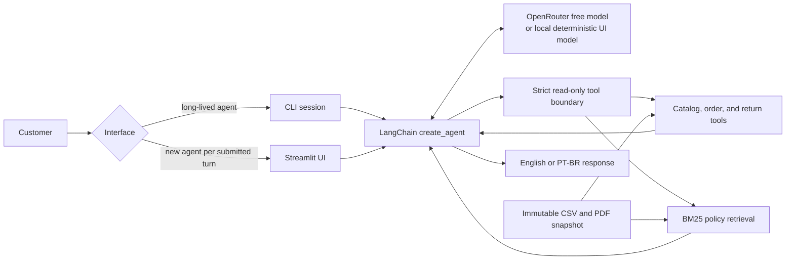

# Empório da Música — AI Customer Support Agent

## Overview

This repository implements a bilingual customer-support agent for Empório da Música, a fictional
musical-instrument store. The application answers customer questions in Brazilian Portuguese or
English and uses source-backed tools for catalog searches, order status, return-window checks, and
store-policy retrieval.

The solution deliberately separates exact business data from language generation. Python functions
query the supplied CSV snapshot deterministically, while a BM25 retriever selects passages from the
PT-BR policy PDF. A configured OpenRouter model decides when to call those tools and writes the final
customer-facing response. The repository includes a CLI, an optional Streamlit evidence UI, offline
tests, opt-in live-model evaluation, and browser evidence.

This is an assessment implementation, not a production customer-service deployment. In particular,
order access has no authentication or ownership check.

## Key Features

- Five read-only tools for product search, product details, order status, return eligibility, and
  policy retrieval.
- Strict Pydantic tool arguments and structured JSON results with source-file and source-row
  evidence.
- Deterministic `Decimal`-based BRL handling and configurable return-deadline reference date.
- Runtime extraction of the supplied eight-page policy PDF into 28 section-level chunks.
- Deterministic BM25 policy ranking with an English-to-PT-BR query glossary.
- English and PT-BR response selection, including language changes between customer turns.
- Bounded LangChain/LangGraph model↔tool loop with fixed provider-error responses.
- Interactive CLI and optional Streamlit UI with tool traces and transcript export.
- Offline unit/orchestration/retrieval tests, opt-in OpenRouter evaluation, and Playwright UI tests.

## Architecture



`langchain.agents.create_agent` provides the standard tool-calling loop and uses LangGraph
internally. A custom graph was not needed because the application has one bounded model↔tools
workflow and no approval, transaction, or multi-agent branch.

The CLI creates one agent and one in-memory checkpointer for the process, so earlier turns are
available to later model calls. The current Streamlit implementation creates a new agent and
checkpointer for every submitted turn. Its transcript remains visible and exportable, but prior
turns are not currently supplied to the next live model call. This distinction is important when
reviewing the language-switch UI evidence.

The model can call only:

- `search_products`
- `get_product`
- `get_order_status`
- `check_return_eligibility`
- `search_policy`

There is no generated SQL, customer lookup, order mutation, payment action, shell execution,
arbitrary network tool, or writable filesystem tool.

## Technology Stack

The project requires Python 3.12 or later and uses `uv` for locked dependency management. Direct
versions resolved in the current `uv.lock` are:

| Component | Locked version | Purpose |
|---|---:|---|
| Python | 3.12.13 locally validated | Runtime |
| LangChain | 1.4.7 | Agent construction and middleware |
| LangChain OpenAI | 1.7.3 | OpenRouter-compatible chat client |
| OpenAI Python SDK | 3.42.0 | Provider protocol and error types |
| pypdf | 6.21.4 | Policy PDF extraction |
| Streamlit | 1.66.1 | Optional web UI |
| Playwright | 1.64.1 | Opt-in browser E2E tests |
| pytest | 9.2.0 | Automated tests |
| Ruff | 0.17.3 | Static checks |

## Project Structure

```text
src/emporio/
  agent.py          Agent construction, bounded turn execution, and CLI
  agent_tools.py    Strict LangChain tool schemas and wrappers
  config.py         Environment configuration
  history.py        Session identifier and readable transcript state
  language.py       Deterministic English/PT-BR response-language selection
  llm.py            Isolated OpenRouter smoke runner
  prompts.py        System behavior and grounding policy
  retrieval.py      PDF extraction, chunking, BM25 index, and policy search
  tools.py          CSV loading and deterministic catalog/order/return logic
  ui.py             Streamlit interface
  ui_helpers.py     UI presets, deterministic test model, and evidence export
tests/               Offline, live, and browser test suites
data/                Supplied immutable PT-BR CSV and PDF inputs
docs/                Requirements, architecture, retrieval, evaluation, and security notes
examples/            Live transcripts and deterministic browser evidence
```

## Getting Started

### Prerequisites

- Python 3.12 or later, or permission for `uv` to install it.
- [`uv`](https://docs.astral.sh/uv/).
- An OpenRouter API key for the CLI or live UI modes. The local deterministic UI mode does not
  make provider requests.

### Install dependencies

```powershell
uv python install 3.12
uv sync --locked
Copy-Item .env.example .env
```

On macOS or Linux, replace the last command with `cp .env.example .env`.

### Configure the API key

Edit the uncommitted `.env` file and replace the placeholder:

```dotenv
OPENROUTER_API_KEY=your_openrouter_api_key_here
```

Never commit a real key. Configuration rejects paid model IDs; use `openrouter/free` or an explicit
model ID ending in `:free`. The repository default is `google/gemma-4-31b-it:free`. The preserved
successful live evaluation used `nvidia/nemotron-3.5-super-vl:free`, so results should not be
generalized to every free model.

Validate the local configuration without making a provider request:

```powershell
uv run emporio --check-config
```

## Environment Variables

| Variable | Required | Default | Purpose |
|---|---|---|---|
| `OPENROUTER_API_KEY` | CLI/live modes | none | OpenRouter credential; never written to traces or documentation |
| `OPENROUTER_MODEL` | No | `google/gemma-4-31b-it:free` | Explicit free model or `openrouter/free` |
| `OPENROUTER_BASE_URL` | No | `https://openrouter.ai/api/v1` | OpenAI-compatible endpoint |
| `REFERENCE_DATE` | No | `2026-03-23` | Deterministic date for return-window decisions |
| `DATA_DIR` | No | `data` | Directory containing the supplied CSV files and policy PDF |

Return eligibility never uses `datetime.now()`; it always uses `REFERENCE_DATE`.

## Running the Application

### CLI

```powershell
uv run emporio --trace
```

Enter a customer question and use `exit` or `quit` to end the session. `--trace` prints concise
tool names and source references to standard error.

Example prompts:

```text
Which acoustic/classical guitars are available for R$1,000 or less?
What's the status of order 8?
Que horas a loja abre no sábado?
Qual é o status do pedido 8?
```

### Streamlit UI

```powershell
uv run emporio-ui
```

The UI offers three execution modes:

- **OpenRouter + auto-fallback:** may use upstream provider fallback and replaces provider failures
  with the local deterministic model. Inspect per-turn model metadata before treating an answer as
  live evidence.
- **OpenRouter strict:** disables the application-level local fallback, although the provider
  fallback checkbox remains independently configurable.
- **Local deterministic:** uses the real LangGraph loop and application tools without calling an
  LLM provider. This mode is for reproducible UI/tool evidence, not model-quality evaluation.

If no API key is available, explicitly select local deterministic mode. The current UI otherwise
falls back to that mode internally even if a live mode is selected.

## Example Conversations

Five genuine OpenRouter conversations are preserved under [`examples/`](examples/README.md):

- [Filtered product search](examples/01-product-search.md)
- [Store opening-hours policy](examples/02-store-policy.md)
- [Order status](examples/03-order-status.md)
- [Out-of-scope request](examples/04-out-of-scope.md)
- [Multi-tool return decision](examples/05-return-multi-tool.md)

They use `nvidia/nemotron-3.5-super-vl:free` and passed the runner's automatic checks. Five saved
responses were subsequently reviewable against their stated human criteria; the full seven-case
live run does not preserve verbatim replies for E06 and E08, so complete open-text review remains
unavailable. See [structured evaluation results](docs/evaluation-results.md).

## UI Testing Evidence

The [UI evidence index](examples/ui-evidence/README.md) links to six screenshots and six WebM
videos. These scenarios used
`local/deterministic-grounded-agent:free` and made zero OpenRouter requests. They demonstrate the
rendered Streamlit UI, tool execution, CSV access, PDF retrieval, evidence panels, and exports; they do not
demonstrate live-model tool choice, model wording, or genuine multi-turn model memory.

## Testing

### Default offline checks

```powershell
uv run ruff check .
uv run pytest
```

Observed on November 2, 2026 with Python 3.12.13:

```text
All checks passed!
172 passed, 13 deselected in 5.61s
```

The 13 deselected cases are seven live-provider cases and six browser E2E cases. The default suite
uses mocked/scripted model behavior and makes no OpenRouter request.

### Browser E2E

```powershell
uv run playwright install chromium
uv run pytest -m e2e tests/e2e -q -s
```

The recorded evidence run passed six scenarios. Re-running this command overwrites the named
artifacts under `examples/ui-evidence/`, so review the resulting Git diff before keeping them.

### Live OpenRouter evaluation

```powershell
uv run pytest -m live tests/live/test_live_flows.py -q -s
```

This is opt-in, consumes provider quota, uses the local `.env`, and can rewrite the five transcript
files when their automatic checks pass. It enforces an 18-request ceiling and disables SDK retries.
Use a strict model/provider configuration when collecting comparable evidence.

## AI Evaluation

The labeled core set contains ten scenarios in `tests/evaluation_cases.json`: catalog filtering,
exact product facts, order status, policy hours, out-of-scope behavior, unknown entities, a
multi-tool return decision, untrusted product text, and simulated provider 429/timeout failures.
Policy retrieval has separate development, held-out, unsupported, and trap sets.

Evaluation separates three evidence levels:

1. Exact offline assertions for structured facts, tool results, source rows, errors, and retrieval.
2. Automatic live checks for required tools, selected answer patterns, citations, and forbidden
   patterns.
3. Human review for usefulness, translation faithfulness, nuanced refusal, injection handling, and
   unsupported claims.

The latest preserved live run attempted seven cases with Nemotron, made 13 provider requests, and
passed all automatic checks. That is not a statistical quality score and not proof of prompt-
injection resistance. Complete human review is unavailable because only five verbatim responses
were saved. Earlier failed and partially passing runs remain in the evaluation log rather than
being rewritten as successes.

## Security Design

Implemented controls include:

- A fixed allowlist of five read-only tools with strict schemas and no arbitrary dispatch.
- No customer-file loading and no customer identity fields in order results.
- Fixed non-sensitive provider and unexpected-tool error messages.
- `SecretStr` for the API key and disabled LangSmith tracing.
- A 1,000-character input limit, 2,048-token model-output limit, 30-second model timeout, no SDK
  retries, five model calls and six tool calls per turn, plus a graph recursion backstop.
- Explicitly untrusted tool/PDF text and source evidence for business facts.
- In-memory, randomly identified CLI sessions with no cross-run persistence.

These controls reduce the impact of prompt injection, excessive agency, sensitive-data exposure,
misinformation, and unbounded consumption. They do not establish production security. Order IDs
are sequential and no authentication or ownership authorization exists; a production deployment
must add both before exposing order data.

See the [threat model](docs/security/threat-model.md) and
[OWASP mapping](docs/security/owasp-mapping.md) for implemented controls, recommendations, and
residual risks.

## Architectural Decisions

[ADR-0001](docs/adr/0001-agent-architecture.md) records the implemented decisions for agent
orchestration, OpenRouter, deterministic structured tools, BM25 policy retrieval, least-agency
security, testing/evaluation, and language support. Supporting detail is available in the
[retrieval evaluation](docs/retrieval.md), [data notes](docs/data-notes.md), and
[requirements traceability matrix](docs/requirements.md).

## Operating Assumptions

- The supplied CSV/PDF snapshot represents the assessment's store system; runtime lookup of that
  snapshot is the implemented interpretation of current or real-time data.
- A promotion is active exactly when its source `is_active` value is `1`.
- A product is available exactly when `status == "active"` and `stock_quantity > 0`.
- For this local demo, possession of an order ID permits a read-only lookup. This is an assessment
  assumption, not acceptable production authorization.
- Delivered orders use `estimated_delivery` as a disclosed proxy for the missing actual receipt
  timestamp when evaluating the seven-day regret window.
- Historical order totals are authoritative source values and are not recomputed from current
  catalog prices.

## Trade-offs and Known Limitations

- Free model availability, latency, rate limits, routing, and tool-call quality can change.
- LLM output is nondeterministic; automatic patterns do not replace human factual review.
- BM25 works well on the 28-chunk labeled corpus but relies on lexical overlap and a hand-maintained
  English glossary. A retrieved passage may be related without answering the question.
- The Streamlit UI currently does not preserve model-visible history between turns.
- UI auto-fallback can hide a live-provider failure unless per-turn model metadata is inspected.
- Conversation state is process-local and not durable.
- Order access has no authentication, authorization, or enumeration protection.
- The CSV/PDF snapshot is treated as the store system; there is no production database, order API,
  inventory feed, payment service, or human-handoff integration.
- `estimated_delivery` is an explicitly disclosed proxy because the supplied orders have no actual
  delivery timestamp.
- Historical order totals are not recomputed from current catalog prices. Additional source
  anomalies are documented in `docs/data-notes.md`.
- Browser evidence covers desktop Chromium only; accessibility, mobile, Firefox, and WebKit are not
  evaluated.

## AI-Assisted Development

OpenAI Codex was used for repository inspection, implementation assistance, tests, verification,
and documentation. Antigravity was used during requirements/test-matrix design and independent
review. The developer remained responsible for scoping changes, inspecting supplied data,
reviewing generated code and documentation, running tests, preserving failed provider evidence,
and deciding what entered the repository. AI-generated output was not treated as validation by
itself.

## Future Improvements

1. Preserve one agent/checkpointer per Streamlit session and add a real multi-turn live test.
2. Add authenticated order access with deterministic ownership authorization and abuse controls.
3. Make live/local fallback status impossible to confuse in the UI and exported evidence.
4. Persist all live responses needed for repeatable human review, including negative/security cases.
5. Add history trimming, deployment-level request budgets, and broader adversarial evaluation.
