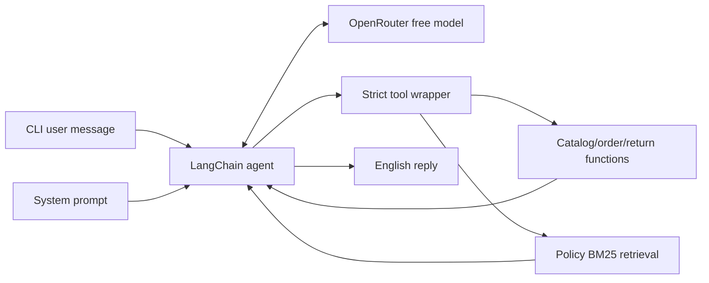

# ADR-0001: Bounded Tool-Calling Agent over Deterministic Local Data

- **Status:** Accepted; amended after retrieval and orchestration evaluation
- **Inputs:** `docs/requirements.md`, `AGENTS.md`, supplied CSV files and policy PDF

## Context

The assessment requires an English customer-support assistant that decides when to consult
catalog, order, and policy data. The supplied snapshot is small (65 products, 20 orders, 28
policy chunks), OpenRouter free requests are limited, customer records must not reach the model,
and all mandatory tests must work without an API key.

## Decision

Build a hybrid system:

1. Deterministic, typed Python functions load and query the immutable local files.
2. Deterministic BM25 retrieval selects verbatim policy passages.
3. A single configurable OpenRouter free model uses function calling to choose among five
   read-only tools and phrase the final English answer.
4. `langchain.agents.create_agent` supplies the bounded model↔tools loop and LangGraph in-memory
   checkpoints. No custom graph, SQL agent, vector database, or multi-agent runtime is used.

The earlier proposal for a hand-written OpenAI SDK loop was superseded when LangChain's standard
agent loop proved sufficient and supplied call-limit middleware and session checkpoints without
adding an extra routing model call.

## Alternatives considered

| Option | Decision | Reason |
|---|---|---|
| Put CSV/PDF content in the system prompt | Rejected | Sends excess data every turn, hides when data was consulted, and weakens evidence boundaries |
| Hand-written OpenAI-compatible tool loop | Superseded | Feasible, but standard LangChain orchestration already provides the required bounded loop |
| Custom LangGraph nodes/classifier | Rejected | No branching or human-in-the-loop workflow justifies the extra code or model call |
| Embeddings/vector database | Rejected for this corpus | BM25 hit@3 meets the documented held-out threshold on only 28 chunks |
| Persistent customer history | Deferred | No account/identity model is in scope; CLI sessions are short |

## Runtime design

At startup:

1. `config.py` loads `.env`, rejects missing keys and model IDs not ending in `:free`, parses
   `REFERENCE_DATE`, and resolves `DATA_DIR`.
2. `tools.py` validates the inspected CSV schemas and identifiers, excludes `customers.csv`, and
   builds the read-only in-memory store.
3. `retrieval.py` extracts the policy PDF, validates its text layer/headings, builds 28 chunks,
   and constructs the BM25 index.
4. `agent.py` builds one `ChatOpenAI` client and one LangChain agent with five structured tools.

Per customer turn:

`ModelCallLimitMiddleware` permits at most five model calls per turn and 30 per thread;
`ToolCallLimitMiddleware` permits six tool calls per turn. A recursion limit of 40 is a final
backstop. The SDK retry count is zero and provider fallback is disabled.

## Tool contracts

The LLM can call exactly the following tools, defined in `agent_tools.py`:

| Tool | Arguments | Result summary |
|---|---|---|
| `search_products` | optional name substring, category enum, inclusive BRL range, status, `available_only`, limit 1–20 | `{count, total_matches, truncated, filters, products}` with price/stock/status/promotion/source |
| `get_product` | exactly one positive `product_id` or complete `exact_name` | `{found, product, evidence}` with description/specs/source |
| `get_order_status` | positive `order_id` | `{found, order, evidence, error}`; no customer identifier/contact fields |
| `check_return_eligibility` | positive `order_id`, `reason=regret|defect` | deterministic time-window decision, source dates, rule section, and `not_checked` limitations |
| `search_policy` | non-empty query up to 200 characters, `k` 1–5 | top-k verbatim passages with section/page/document/hash evidence |

No tool performs writes, accepts arbitrary code/SQL, loads customer records, or calls a network
service. Not-found and malformed inputs return structured data. Unexpected exceptions are logged
by class only and become a generic `tool_failure` message.

## Retrieval decision

The policy is PT-BR while customer questions are English. Retrieval uses accent-folded BM25 over
section/subsection chunks plus a hand-written English→PT-BR glossary. The model is encouraged to
send short PT-BR keywords, but English queries also work through expansion. Results contain
verbatim passages; lexical overlap alone is not considered an answer. See `docs/retrieval.md` for
the labeled benchmark and limitations.

## Prompt and trust boundaries

- The system prompt contains behavior, not store facts.
- Customer input is always a user message.
- Tool output and policy passages are untrusted JSON data in tool messages.
- Prices, stock, orders, dates, and policies must come from a current tool result.
- Policy claims require section/page citations.
- The assistant cannot mutate orders or retrieve customers by identity.
- `customers.csv` is never loaded; order results exclude `customer_id`.
- LangSmith tracing is forced off. Only the active conversation and selected non-customer tool
  data are sent to OpenRouter.

Instruction labeling and role separation reduce prompt-injection risk but do not prove that every
model will resist malicious data. The real-model injection evaluation is still pending because the
latest live run was rate limited.

## Provider and error handling

| Failure | Behavior |
|---|---|
| Invalid startup configuration/source schema/PDF | Fail before chat with a concise startup error |
| Malformed tool arguments | Framework/schema error returned to the model, which may correct it within limits |
| Unknown product/order/policy answer | Structured no-result; prompt requires an explicit not-found response |
| HTTP 429 | Fixed rate-limit message; no retry |
| Timeout/connection failure | Fixed unreachable message; no retry |
| Other provider status | Fixed provider-error message; no exception body or secret logged |
| Model/tool-call limit | Fixed step-limit response; no extra model call |

## State and privacy

LangGraph's `InMemorySaver` stores messages under a random thread ID for one process. The CLI also
keeps a small readable transcript in `history.Session`. Separate sessions do not share state and
nothing persists across runs.

For the assessment demo, possession of an order ID permits lookup. This is not production-ready
authorization; a deployed service must authenticate the customer and verify order ownership.

## Consequences

Positive:

- Exact business facts and sources are independently testable offline.
- The model cannot invent new database queries or perform transactions.
- Policy relevance is measurable without consuming provider quota.
- Provider calls and tool loops have explicit upper bounds.

Negative:

- Free-model availability and tool-choice quality remain external risks.
- Tool schemas and message history consume context on every model call.
- The glossary requires maintenance as policy/customer vocabulary changes.
- Final-answer faithfulness and prompt-injection resistance still require genuine live evidence
  and human review.
