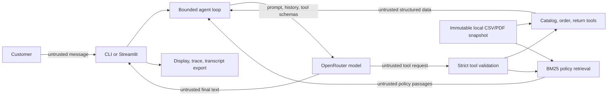

# Security Threat Model

## 1. Scope and method

This threat model covers the Empório da Música assessment application as implemented in this
repository: the CLI, the optional Streamlit evidence UI, the LangChain/LangGraph agent loop, the
OpenRouter model boundary, five read-only tools, local CSV data, deterministic policy retrieval,
in-memory conversation state, traces, and transcript exports.

It uses the official [OWASP Top 10 for LLM Applications
2026](https://genai.owasp.org/resource/owasp-genai-llm-top-10-2026/) and [OWASP Top 10 for
Agentic Applications 2026](https://genai.owasp.org/resource/owasp-top-10-for-agentic-applications-for-2026/).
The detailed all-ten mappings are in [`owasp-mapping.md`](owasp-mapping.md).

This is a threat model for a local assessment demo, not a penetration-test report or a security
certification. Prompt instructions are treated as partial controls, never as proof that a model
cannot be manipulated.

### Priority scale

| Priority | Meaning |
|---|---|
| P0 | Submission-critical risk or production blocker; must be explicit and evidenced |
| P1 | Important defense-in-depth or operational risk |
| P2 | Low-impact in this architecture, or intentionally out of scope with justification |

Control status is stated as **implemented**, **recommended**, or **out of scope**. Recommended
controls are not claims about the current system.

## 2. System and security objectives

The agent answers customer questions about products, orders, return windows, and store policy.
Structured facts are obtained from deterministic Python tools; policy evidence is retrieved from
the supplied PDF with deterministic BM25 ranking. A configured OpenRouter model selects tools and
phrases the answer. The optional local deterministic UI mode exercises the same tools but is not
evidence of real-model security behavior.

Security objectives:

1. Store facts must come from current tool results, not model memory.
2. Untrusted user, CSV, and PDF text must not change the application's security policy.
3. The model must have no write, transaction, code-execution, or arbitrary-query capability.
4. Customer identity and credentials must not be exposed.
5. Provider failures and resource exhaustion must be bounded and non-leaking.
6. Limitations must remain visible; a fluent answer is not treated as verified merely because it
   sounds plausible.

## 3. Assets and threat actors

### Assets

| Asset | Security property |
|---|---|
| OpenRouter API key | Confidentiality; must never enter prompts, traces, exports, or error text |
| Customer conversation | Confidentiality and session isolation |
| Order data | Confidentiality and integrity; tracking and payment data are operationally sensitive even without names |
| Catalog and policy data | Integrity and provenance |
| Tool allowlist and schemas | Integrity; they define the model's maximum agency |
| Reference date and eligibility rules | Integrity and reproducibility |
| Provider quota and local resources | Availability and bounded consumption |
| Evaluation evidence | Integrity; results must not be rewritten as successes |

The system prompt is hidden context but is not treated as a secret. Security must not depend on
an attacker being unable to infer or reproduce it.

### Threat actors

- A customer intentionally attempting prompt injection, data extraction, order enumeration, or
  resource exhaustion.
- A benign customer whose pasted content accidentally contains instructions for another model.
- A contributor or upstream process able to modify CSV/PDF source data or evaluation fixtures.
- A compromised Python dependency, model artifact, provider, or provider route.
- The model itself producing an incorrect tool call or unsupported, overconfident answer without
  malicious intent.

## 4. Data flow and trust boundaries

| Boundary | Untrusted side | Trusted enforcement point | Principal risks |
|---|---|---|---|
| TB1 | Customer message | Input length check and system policy | Direct prompt injection, denial of service, out-of-scope requests |
| TB2 | Application request | OpenRouter client configuration | Conversation disclosure, provider compromise, quota exhaustion |
| TB3 | Model-generated tool call | Fixed allowlist and strict Pydantic schemas | Tool misuse, malformed arguments, excessive agency |
| TB4 | Local source files | Typed loaders, schema/reference validation, policy hash test | Data poisoning, malformed data, stale or replaced policy |
| TB5 | Retrieved/tool content | Tool-message role and explicit untrusted-data labeling | Indirect prompt injection, unsupported claims |
| TB6 | Earlier conversation turns | Random thread ID and in-memory checkpointer in the long-lived CLI agent | Context poisoning and cross-session disclosure; the current UI rebuilds its checkpointer per turn |
| TB7 | Model reply and trace | CLI/Streamlit rendering and export code | Misinformation, unsafe links, disclosure through exported artifacts |
| TB8 | Dependencies, model IDs, provider routing | `uv.lock`, configuration validation, code review | Software/model supply-chain compromise |

## 5. Attack surfaces

### Customer input

The customer can submit direct jailbreaks, encoded or multilingual instructions, attempts to
reveal hidden context, oversized text, or plausible-looking requests for another customer's order.
Input is capped at 1,000 characters, but there is no user identity, per-user rate limit, or
deployment-level abuse control.

### Retrieved and structured data

Product descriptions, order notes, and policy passages are data that the model reads. A valid CSV
or PDF can therefore contain an indirect prompt injection. Schema validation proves structure, not
that natural-language content is benign. The policy PDF is hash-pinned in a regression test; the
CSV files are not all cryptographically pinned.

### Tool boundary

The model can call exactly `search_products`, `get_product`, `get_order_status`,
`check_return_eligibility`, and `search_policy`. All are read-only and have strict input schemas.
There is no arbitrary SQL, shell, code interpreter, filesystem write, email, payment, or order
mutation capability. Valid read operations can still be abused, particularly by enumerating
sequential order identifiers.

### Provider boundary

The active conversation, system prompt, tool schemas, and selected non-customer tool output are
sent to OpenRouter for live operation. `customers.csv` is not loaded, but order results can contain
tracking, payment, dates, and line items. Free-model availability and upstream routing are external
dependencies.

### Output and evidence surfaces

The CLI prints plain text. Streamlit renders Markdown and can export conversation evidence. The
output is not executed as code or used to authorize a transaction, substantially reducing impact
from improper output handling. Users can still follow malicious links or over-trust a polished
answer, and exported transcripts may contain customer-entered information.

## 6. Prioritized risk register

### TM-01 — Prompt injection and agent goal hijack

- **OWASP IDs:** LLM01:2026, ASI01, ASI06.
- **Attack scenario:** A customer says to ignore the system prompt, or an instruction is planted in
  a product description, order note, or policy passage. The model follows it, reveals hidden
  context, changes scope, or selects an unrelated tool.
- **Applicability:** High. Both direct messages and retrieved/tool content enter the model context.
- **Implemented mitigations:** Fixed read-only tools; strict tool schemas; system, user, and tool
  roles; tool output explicitly labeled as untrusted data; no persistent cross-run memory.
- **Recommended mitigations:** Expand adversarial tests across direct, product, order-note, and
  policy surfaces. Treat any future memory write or state-changing tool as a privileged design
  change requiring a new threat review.
- **Verification:**
  `tests/test_agent.py::test_instruction_like_policy_text_stays_data`,
  `tests/test_retrieval.py::test_instruction_like_policy_text_is_returned_verbatim_as_data`, and
  `tests/test_evaluation.py::test_e08_instruction_like_product_description_remains_data`.
- **Residual risk:** Role separation and labels reduce risk but cannot guarantee that a model will
  ignore adaptive injection. The latest genuine E08 run passed its automatic forbidden-pattern and
  true-price checks, but its final response body was not preserved, so the open-text injection
  criteria cannot be independently reviewed.
- **Priority:** P0.

### TM-02 — Order disclosure and identity/privilege abuse

- **OWASP IDs:** LLM02:2026, ASI03, ASI02.
- **Attack scenario:** An attacker guesses sequential order IDs and retrieves status, dates,
  payment method, tracking code, and line items for orders they do not own.
- **Applicability:** High. Order lookup requires only a positive order number.
- **Implemented mitigations:** `customers.csv` is never loaded; `customer_id`, names, email, phone,
  and city are excluded; no lookup by identity; tools are read-only.
- **Recommended mitigation:** Production deployments must authenticate the customer, authorize
  order ownership in deterministic application code, add abuse monitoring, and minimize returned
  fields. This is intentionally not implemented for the assessment demo.
- **Verification:**
  `tests/test_order_tools.py::test_order_output_never_exposes_customer_identity` and
  `tests/test_tools.py::test_orders_exclude_personal_data_and_preserve_totals`.
- **Residual risk:** Removing direct identity fields does not make order operational data public.
  The current possession-of-ID rule is a production blocker.
- **Priority:** P0.

### TM-03 — Tool misuse and excessive agency

- **OWASP IDs:** LLM03:2026, ASI02, ASI08.
- **Attack scenario:** A hijacked or mistaken model repeatedly invokes valid tools, attempts extra
  fields such as `customer_id`, or uses broad queries to collect more information than needed.
- **Applicability:** Medium to high. The tools are safe from writes but still expose read data.
- **Implemented mitigations:** Five-tool allowlist; `extra="forbid"` argument schemas; no arbitrary
  dispatcher; no network or mutation tools; six tool calls and five model calls per turn; generic
  non-leaking tool failures.
- **Recommended mitigations:** If exposed beyond a local demo, add deterministic authorization,
  per-user query budgets, order-enumeration detection, and field-level response minimization.
- **Verification:**
  `tests/test_agent.py::test_registered_tools_are_exactly_the_approved_read_only_set`,
  `test_malformed_tool_arguments_give_structured_error_and_loop_continues`, and
  `test_runaway_tool_loop_stops_at_the_model_call_cap`.
- **Residual risk:** A schema-valid read can still be inappropriate. Tool validation does not
  establish customer intent or ownership.
- **Priority:** P0.

### TM-04 — Misinformation and unsupported business claims

- **OWASP IDs:** LLM07:2026, ASI09, ASI08.
- **Attack scenario:** The model invents a product, price, stock level, delivery date, policy rule,
  or return decision, or overstates what a retrieved passage proves.
- **Applicability:** High because the output directly informs customer decisions.
- **Implemented mitigations:** Typed deterministic queries; `Decimal` prices; exact not-found
  behavior; source rows; policy section/page evidence; configured reference date; labeled
  retrieval evaluation; prompt grounding rules.
- **Recommended mitigations:** Keep exact structured evaluations and explicit human review for
  open text. A production response layer should validate required evidence before displaying
  high-impact claims rather than using another LLM as the validator.
- **Verification:** `tests/test_evaluation.py` cases E01–E07,
  `tests/test_order_tools.py`, `tests/test_tools.py`, and supported/unsupported/trap cases in
  `tests/test_policy_eval.py`.
- **Residual risk:** Correct evidence retrieval does not prove that a live model will select the
  correct tool or faithfully state the evidence. Fluent output can create unwarranted trust.
- **Priority:** P0.

### TM-05 — Sensitive context and secret disclosure

- **OWASP IDs:** LLM02:2026, LLM08:2026.
- **Attack scenario:** A user asks for the system prompt, earlier messages, API key, internal path,
  exception body, or raw records; a failure accidentally includes a credential in the response or
  trace.
- **Applicability:** Medium. Hidden context and provider-bound conversations exist, although the API
  key is not intentionally placed in model context.
- **Implemented mitigations:** `SecretStr`; settings repr suppression; fixed customer-safe failure
  messages; logs contain error classes rather than exception bodies; concise source-only trace;
  separate thread IDs; LangSmith tracing forced off.
- **Recommended mitigations:** Never store secrets in prompts or source documents. Review exports
  before sharing and define retention/access controls if transcripts become persistent.
- **Verification:**
  `tests/test_config.py::test_settings_repr_never_contains_api_key`,
  `tests/test_agent.py::test_chat_model_is_free_only_without_retries_and_hides_the_key`,
  `test_unexpected_tool_exception_does_not_leak_details`,
  `test_provider_failures_map_to_fixed_messages_without_retry_or_leak`, and
  `test_separate_sessions_do_not_share_memory`.
- **Residual risk:** The provider receives the active conversation and selected tool data. The
  system prompt can be inferred or reproduced and must not be treated as a secret boundary.
- **Priority:** P0 for order disclosure; P1 for hidden prompt/context exposure.

### TM-06 — Unbounded consumption and availability loss

- **OWASP IDs:** LLM06:2026, ASI08.
- **Attack scenario:** A user submits repeated requests, induces a tool loop, opens many sessions,
  or causes slow provider calls until free quota, memory, or concurrency is exhausted.
- **Applicability:** Medium for a local assessment; high if the Streamlit UI is publicly exposed.
- **Implemented mitigations:** 1,000-character input limit; 2,048 output-token limit; 30-second model
  timeout; zero SDK retries; five model calls and six tool calls per turn; 30 model calls per
  thread; recursion backstop; 18-request live-evaluation ceiling; fixed 429/timeout behavior.
- **Recommended mitigations:** A deployed service needs authenticated rate limits, concurrency
  caps, global spend/request budgets, monitoring, and retention limits. Session reset must not reset
  the deployment-wide budget.
- **Verification:**
  `tests/test_agent.py::test_over_long_or_blank_input_never_calls_the_model`,
  `test_runaway_tool_loop_stops_at_the_model_call_cap`,
  `tests/test_evaluation.py::test_live_request_budget_fails_before_request_nineteen`, and
  `test_provider_negative_paths_are_exact_and_do_not_retry_or_leak`.
- **Residual risk:** No per-user or deployment-wide limiter exists. A client can create fresh
  sessions, and process concurrency is not bounded by application code. The Streamlit UI creates a
  fresh agent/checkpointer for each turn, so its thread-level model-call counter does not accumulate
  across submitted turns.
- **Priority:** P1.

### TM-07 — Source, retrieval, and supply-chain poisoning

- **OWASP IDs:** LLM04:2026, LLM05:2026, ASI04, ASI06.
- **Attack scenario:** A dependency, model route, CSV row, policy PDF, or evaluation fixture is
  replaced with malicious or misleading content that still satisfies structural validation.
- **Applicability:** Medium. The corpus is local and controlled, but it is part of the software and
  data supply chain.
- **Implemented mitigations:** Locked dependency resolution; typed schema and referential-integrity
  checks; duplicate-ID rejection; fail-fast policy headings/text-layer checks; policy SHA-256 pinned
  in a test; source provenance in results.
- **Recommended mitigations:** Review lockfile changes, pin/verify all supplied data hashes for a
  frozen submission, produce an SBOM for production, and avoid silently changing provider model
  routes during an evaluation run.
- **Verification:**
  `tests/test_retrieval.py::test_real_pdf_is_pinned_and_has_text_layer`,
  `test_missing_heading_fails_fast`, duplicate/missing-column tests in `tests/test_tools.py` and
  `tests/test_order_tools.py`, plus `uv sync --locked`.
- **Residual risk:** A lockfile is not a signature or provenance guarantee. Most CSV files are not
  cryptographically pinned, and remote model implementation/routing cannot be independently
  attested by this application.
- **Priority:** P1.

### TM-08 — Improper output handling and human trust exploitation

- **OWASP IDs:** LLM10:2026, ASI09.
- **Attack scenario:** The model returns a malicious Markdown link, misleading citation, or polished
  unsupported explanation that a user trusts or exports.
- **Applicability:** Low to medium. Output is displayed and exported but never executed as code or
  used directly for a transaction.
- **Implemented mitigations:** No `eval`, shell, SQL, browser automation, or transaction sink;
  concise evidence traces; Streamlit does not enable arbitrary HTML in the application code.
- **Recommended mitigations:** Treat model text and transcript files as untrusted, avoid automatic
  link activation, and retain visible model/evidence/error labels. Do not equate runtime success
  with factual correctness.
- **Verification:** `tests/test_ui_helpers.py::test_export_evidence_markdown_and_json` and manual
  review with malicious Markdown and deceptive citations.
- **Residual risk:** Users can still follow links or act on misinformation. Export consumers may
  render Markdown differently.
- **Priority:** P2 for output execution; P0 under TM-04 for over-trust in business claims.

## 7. Controls deliberately not added

- **A second LLM guardrail:** not deterministic, adds cost and another injection/failure surface.
- **A vector database or embedding filter:** the corpus has 28 policy chunks and deterministic BM25
  already meets the documented retrieval threshold. Adding embeddings would introduce an
  otherwise absent LLM09 surface.
- **Generic input sanitization as an injection guarantee:** visible malicious text can be meaningful
  customer data, and current models do not provide a reliable instruction/data separation. The
  primary defense is limiting capability and validating tool calls.
- **Broad agent autonomy:** there is no need for write tools, planning agents, background tasks,
  code execution, or inter-agent communication in this assessment.

## 8. Verification summary and known gaps

The offline suite covers deterministic facts, tool schemas, source evidence, unknown entities,
CLI session isolation, one indirect-injection pattern, provider failures, and invocation limits.
The latest live run observed correct automatic tool/pattern checks for seven cases, but only five
response bodies are preserved for human review. Neither result proves general semantic faithfulness,
adaptive prompt-injection resistance, genuine UI multi-turn memory, or production authorization.
Those limitations must remain visible in the README and evaluation results.

No live security result should be recorded as passing unless the exact provider/model run succeeds
and open-text cases receive the documented human review.
